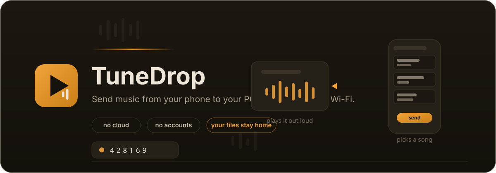

# TuneDrop

<p align="center">
  
</p>

<p align="center">
  <a href="LICENSE"></a>
  
  
  <a href="https://github.com/Ekkh1300/tunedrop/releases/latest"></a>
</p>

**Send music between your devices on your own Wi-Fi.** The phone picks the songs — the PC plays them. Nothing leaves the living room.

TuneDrop is a small self-hosted web app: the host machine (PC) starts a room and shows a QR, any device on the **same LAN** opens the site (or scans the QR), and uploads/imported songs appear **live** on every paired device — no refresh, no cloud, no accounts.

## Features

- **Phone → PC transfer library**: upload MP3 / WAV / OGG / M4A / FLAC / AAC / WebM from any paired device, per-file progress bars.
- **Import by link**: paste a direct `https://…` audio link; the server downloads it (with SSRF-safe fetch), then treats it like an upload.
- **Realtime sync on the LAN**: songs, deletes and presence travel over one WebSocket — both sides stay live without manual refresh.
- **Real player on the PC**: play/pause, previous/next, seek, volume, mute, now-playing + cover art, and drink-from-the-pipe `206 Partial Content` streaming so seeking works exactly like a normal media server.
- **QR pairing with rotating tokens**: the QR carries a one-shot join token that refreshes automatically before a 15-minute lifetime; a 6-digit code is the fallback for when the QR is hard to scan.
- **Honest metadata**: title/artist/album/duration/cover extracted with `music-metadata`, with a built-in ID3v2 fallback for files that carry a tag ahead of a WAVE/FLAC/OGG container.
- **Tidy data**: uploaded files are re-sniffed (magic bytes — not extension), renamed to UUID storage names, originals are only ever used for display.
- **Per-room storage ceiling**, file-size cap, rate limits on room ops and imports, and a housekeeper that sweeps stale empty rooms.

## Requirements

| Thing | Version |
| --- | --- |
| Node.js | **22.5+** (`node:sqlite` is used — no native deps, no rebuild). Newer LTS/current releases fine. |
| Browsers | Any modern Chromium/Firefox/Safari — it drives a plain `<audio>` element. |
| Network | Phone and PC on the **same Wi-Fi/switch**. Guest networks with client isolation will block this. |

> Windows / macOS / Linux all work. On Windows allow Node.js through Windows Defender Firewall when prompted (or see Troubleshooting).

## Quick start (development)

```bash
npm install          # installs server + client workspaces (checks your Node version)
npm run dev          # runs the API server (:8787) with the Vite dev server (:5173) hot-reloading
```

- PC: open **http://localhost:5173** → *Broadcast from here* → *Create library & show QR*
- Phone: open the LAN URL shown in the QR panel (e.g. `http://192.168.1.20:8787`) → scan, or open the same site on the phone and type the 6-digit code.

## Production (single port, no Vite)

```bash
npm install
npm run build        # builds client/dist
npm start            # serves the API + the built UI together on :8787
```

Open `http://<PC-LAN-IP>:8787` from the phone exactly like above. `PORT` / `HOST` can be overridden (see configuration).

## How pairing works

1. **Host** clicks *Create library* → `POST /api/rooms` → the server returns a 6-digit `code`, a long random `secret` (kept only in localStorage on that device) and a short-lived `joinToken`.
2. The QR panel renders `joinToken`-bearing URLs for every LAN interface; you can pick the interface with the dropdown if auto-detection guesses wrong (e.g. when your PC sits behind WSL2 or VPN adapters).
3. **Guest** opens `http://<ip>:8787/#/join?code=…&token=…` or types just the code. Correct code **or** valid token is accepted — both give back a member `secret`. Tokens expire (`JOIN_TOKEN_TTL_SEC`, default 15 min) and refresh themselves before expiry, so an expired QR is only ever a scan away from a fresh one.
4. Both sides join the same Socket.IO room; presence, `songAdded` and `songRemoved` events keep them in sync.

Clearing the site's storage (or *Disconnect* in the header) un-pairs the device; the host can also delete songs to prune the library.

## Configuration

Everything is an environment variable; defaults fit a LAN living room:

| Variable | Default | Meaning |
| --- | --- | --- |
| `PORT` | `8787` | API/UI port (also baked into QR URLs) |
| `HOST` | `0.0.0.0` | Listen interface |
| `PUBLIC_PORT` | `= PORT` | Override when the phone should hit a proxy instead |
| `PUBLIC_HOST` | *(unset)* | Public base for QR URLs, e.g. `my-tunnel.example.com` or `https://sub.example.com` — for pairing **from another internet** (see *Beyond the LAN*). Refresh the code after changing it |
| `MAX_UPLOAD_MB` | `150` | Per-file cap (upload **or** link import) |
| `MAX_ROOM_STORAGE_MB` | `2048` | Per-room library ceiling on disk |
| `JOIN_TOKEN_TTL_SEC` | `900` | QR join-token lifetime (60 s – 24 h) |
| `IMPORT_TIMEOUT_SEC` | `90` | Fetch budget for link imports |
| `DEV_ORIGIN` | `http://localhost:5173` | CORS exception for the Vite dev server only |
| `DATA_DIR` | `server/data` | Where SQLite DB, uploads and covers live |

Data lives in `server/data/` (`tunedrop.db`, `uploads/`, `covers/`). Everything is regenerable except your songs — keep that folder if you reinstall.

## HTTP + WebSocket API

All JSON routes require `X-TuneDrop-Code` + `X-TuneDrop-Secret` headers (the pairing secrets the browser stores); `<audio>` and cover URLs use query params so the media element can work unauthenticated-cookie-less:

| Method | Path | Purpose |
| --- | --- | --- |
| `POST` | `/api/rooms` | Create room (host). Returns code + secret + first join token + LAN URL candidates + port. |
| `POST` | `/api/rooms/:code/join` | Join by code (optional `body.token`). Refreshes token TTL counters. |
| `POST` | `/api/rooms/:code/qr` | Rotate join token + render QR SVG (+ LAN URL candidates). Members only. |
| `GET` | `/api/songs` | List library. |
| `POST` | `/api/songs/upload` | Multipart upload (field name `files`), sniffed + metadata-extracted. |
| `POST` | `/api/songs/import-url` | `{ url }` import through the SSRF-safe fetcher. |
| `DELETE` | `/api/songs/:id` | Remove a song (and its file + cover). |
| `GET` | `/api/songs/:id/stream?room=…&secret=…` | `206` Range streaming of the audio file. |
| `GET` | `/api/songs/:id/cover?room=…&secret=…` | Extracted cover art PNG/JPEG. |

Socket events: `presence` `{devices: [{id, kind, name}]}`, `songAdded` `song`, `songRemoved` `id`.

## Security posture (and honest limits)

**Implemented**

- Uploads are stored by UUID, never by user-controlled names; filename only appears in metadata.
- File type is decided by magic bytes (first 4.5 KB), not by extension or by the multipart MIME claim; unsupported payloads are rejected.
- Link imports only follow `http(s)://` **public** targets; loopback / private ranges / multicast / non-443-ports are refused before a connection is made, redirects are bounded, protocols re-validated after each hop.
- In-memory sliding-window rate limits: 30 create/join/QR per minute/IP, a tighter burst on imports; room auth is a long random secret, never the code alone; every pairing token is one-shot-ish (rotates before expiry) and the socket membership validates against the DB.
- Body/multipart limits independent of the client, CRLF-protection on all `http` header echoes, and correct `416` handling for out-of-range requests.

**Assumptions**

- This is a **LAN-trust** product: Wi-Fi with WPA2+ encryption. The QR/token model minimizes shoulder-surfing but does not aim to defend an adversarial LAN. Do not forward TuneDrop to the Internet as-is; Phase 3 (real WAN) needs the relay/tunnel work that the separate `AriTun` project covers.

## Beyond the LAN (two different internets)

Two no-server recipes first, then the tunneled one:

- **Phone hotspot (easiest):** connect the PC to the phone's hotspot — the hotspot adapter appears in the pairing panel's **Network** dropdown; pick it and scan. Works from PC→phone-data with zero tools.
- **Tailscale mesh (different networks, no VPS):** install Tailscale on PC and phone, sign into the same account — the `Tailscale` adapter then shows up in the **Network** dropdown like any other interface, and the phone reaches the PC from any internet.
- **A public tunnel + `PUBLIC_HOST`:** front `http://localhost:8787` with a tunnel, then point TuneDrop at that address:

```powershell
# example with a quick cloudflared tunnel
cloudflared tunnel --url http://localhost:8787
# it prints something like https://x-y-z.trycloudflare.com, then:
set PUBLIC_HOST=https://x-y-z.trycloudflare.com
npm start
```

The QR/panel now hands out the public address (the **Network** dropdown lists both LAN and internet), and the phone opens the same code/token pairing over it. Other tools work the same: `ngrok http 8787`, or `ssh -R 80:localhost:8787 user@your-domain`.

Security note: pairing over the internet trusts the tunnel transport. Keep `JOIN_TOKEN_TTL_SEC` short (default 15 min is fine), don't run the tunnel permanently unless you use it, and room secrets are bearer credentials — the URL alone cannot join without the code/token.

## Use as a desktop app (Windows)

No Electron — a **single self-contained exe** does the job. Both artifacts ship on the [**latest GitHub release**](https://github.com/Ekkh1300/tunedrop/releases/latest):

- **`app/TuneDrop-Setup.exe`** (~27 MB) — the real installer: Inno-Setup wizard, per-user install to `%LOCALAPPDATA%\Programs\TuneDrop` (no admin), Desktop + Start-menu shortcuts, MIT license page, and a proper **Uninstall** entry in Windows Settings. rebuild it with `ISCC installer\tunedrop.iss`.
- **`app/TuneDrop.exe`** (~101 MB) — the same app unpacked, portable: run it from anywhere and it behaves as an installed app (first run creates the shortcuts itself, `--uninstall` removes them; `--no-open` skips the browser). Rebuild any time with `npm run exe`.
- Songs/db live in the `data` folder next to the installed exe — client/dist UI and the Node runtime are embedded in the binary.
- Uploaded songs are always saved under the data dir (`server/data/uploads/` in repo runs) — and each library card has a **Save this file** button to download a copy anywhere you like.
- **`TuneDrop.bat`** (+ **`TuneDrop (silent).vbs`**) — the classic launcher for devs running from the repo.

## Testing

```bash
npm run smoke        # 23-check API suite against a live server on :8787
```

The suite covers room lifecycle, pairing auth failures, upload validation, metadata/handling of ID3-tagged WAVs, range streaming, storage caps, delete + housekeeping, SSRF refusals and rate limiting — against a fresh tmp-data server.

On top of the smoke suite, the full GUI loop was hand-tested in a real browser: host room → second tab joins by code → upload from the "phone" tab → song appears on the PC tab live → clicked play (206+range verified in the network panel) → link import → reload re-pairs from localStorage. Known cosmetic leftovers: none observed during the final pass.

## Troubleshooting

| Symptom | What to do |
| --- | --- |
| QR URL looks like `http://172.19.x.x…` and the phone can't open it | Pick a real Wi-Fi interface in the QR panel's **Network** dropdown (WSL2/VPN adapters often shadow the first interface). |
| `429 Too many attempts — wait a minute…` | Sliding-window limiter on create/join/QR — wait out the minute. Smoke-suite runs and manual testing share the budget. |
| Phone opens the app but the code never joins | Check the tab dropdown interface, check the code, and note guest-network isolation blocks mDNS-less LAN reach. |
| Windows asks about firewall the first time | Allow Node.js on private networks — incoming LAN access is required for the phone to connect. |
| First click on a song doesn't start audio | Browsers block autoplay until the user interacts once; the second click always works. |
| Two devices in one browser show "(2) online" and share state | Same browser profile = same localStorage. Use normal web tabs/phones — this is expected behavior in real networks, not a bug. |

## Project structure

```
tunedrop/
├── package.json             # workspaces + scripts
├── scripts/
│   ├── dev.mjs              # spawns server + vite together
│   ├── check-node.mjs       # friendly node version check at install
│   ├── api-smoke.mjs        # 23-test backend coverage
│   ├── build-exe.mjs        # single-file TuneDrop.exe (esbuild + SEA + postject)
│   └── make-icon.mjs        # generates assets/tunedrop.ico from code
├── server/
│   ├── src/
│   │   ├── index.js         # express + socket.io bootstrap
│   │   ├── app.js           # middleware + routes + static serving
│   │   ├── config.js        # env-driven limits/paths
│   │   ├── db.js            # node:sqlite schema + queries
│   │   ├── sockets.js       # room-presence + song events
│   │   ├── routes/          # rooms.js, songs.js
│   │   ├── services/        # rooms.js, songs.js, importer.js
│   │   └── utils/           # fileTypes (sniff+ID3), ssrf, lan, rateLimit, errors
│   └── data/                # runtime: sqlite + uploads + covers
└── client/
    ├── src/
    │   ├── api.js / lib/    # fetch client, socket, storage
    │   ├── store.jsx        # room state, uploads, player state, toasts
    │   ├── App.jsx
    │   └── components/      # EntryView, Header, ReceiverPanel (QR), UploadPanel,
    │                        # SongGrid, PlayerBar, DevicesStrip, Waveform, Icons, Toasts
    └── dist/                # built UI served by the server in production

assets/tunedrop.ico is the exe icon (generated); app/TuneDrop.exe is the
packaged single-file build and app/TuneDrop-Setup.exe the installer
(see `npm run exe` and installer/tunedrop.iss).
```

## Design notes / inspiration

- The room-code + host-secret + rotating-tokens pairing model was shaped by the UX of [Ariyan_911's **SyncBeat**](https://github.com/Ariyan-2678/SyncBeat) ("listen together" rooms), but TuneDrop is written from scratch with a different priority: moving actual music files on your LAN instead of syncing a shared queue.
- [**AriTun**](https://github.com/Ariyan-2678/AriTun) (self-hosted ngrok) is the natural Phase-3 partner for exposing TuneDrop outside the LAN over a tunnel, instead of bolting a WAN relay inside this codebase.

## License

MIT — see [`LICENSE`](LICENSE).
